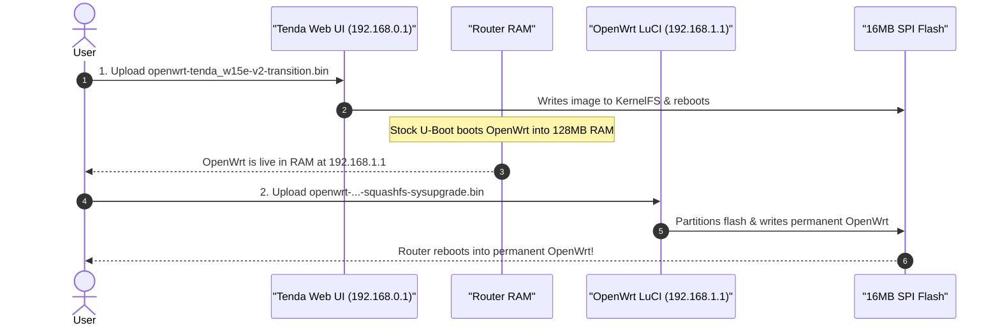

# OpenWrt Port for Tenda W15E v2.0

This repository contains all source code, Device Tree configurations, patches, automated build scripts, and utilities for building and flashing **OpenWrt 23.05** onto the **Tenda W15E v2.0** enterprise wireless router.

---

## Hardware Specifications

| Component | Hardware Details |
| :--- | :--- |
| **SoC** | Qualcomm Atheros **QCA9531** (MIPS 24Kc @ 650 MHz) |
| **OpenWrt Target** | `ath79/generic` |
| **Flash** | **16 MB** SPI NOR Flash (`0x1000000` bytes) |
| **RAM** | **128 MB** DDR2 |
| **Ethernet Switch** | Qualcomm `qca_shival` (5x 10/100 Mbps Fast Ethernet: 1-4 WAN, 1-4 LAN configurable) |
| **2.4 GHz Wi-Fi** | Integrated in QCA9531 (2x2 MIMO 802.11b/g/n, driven by `ath9k`) |
| **5 GHz Wi-Fi** | PCIe radio (802.11a/n/ac up to 867 Mbps, driven by `ath10k`) |
| **Calibration** | Stored in 64 KB `art` partition at flash offset `0xff0000` |

---

## Directory Layout

```text
openwrt-port/
├── README.md                      # Comprehensive installation and development guide
├── PLAN.md                        # Reverse-engineering notes and roadmaps
├── SQUASHFS_PATCH_GUIDE.md        # Technical guide to Tenda's obfuscated SquashFS
├── Dockerfile                     # Isolated Ubuntu 22.04 OpenWrt build container
├── bin/                           # Compiled firmware output binaries
│   ├── openwrt-tenda_w15e-v2-transition.bin          # Stage 1: Web GUI transition image
│   ├── openwrt-ath79-generic-tenda_w15e-v2-squashfs-sysupgrade.bin # Stage 2: Final OpenWrt flash image
│   └── openwrt-ath79-generic-tenda_w15e-v2-initramfs-kernel.bin    # Direct RAM/TFTP test image
├── dts/
│   └── qca9531_tenda_w15e-v2.dts  # OpenWrt Device Tree source
├── patches/
│   └── 01-add-tenda-w15e-v2.patch # Git patch for target/linux/ath79/image/generic.mk
└── scripts/
    ├── docker_build.sh            # One-click automated container build script
    ├── build_openwrt.sh           # Native Linux build script
    ├── wrap_tenda_firmware.py     # Wraps OpenWrt with Tenda 64-byte vendor upgrade header
    └── dump_art_extractor.py      # Extracts and validates the 64 KB ART calibration partition
```

---

## Flashing Guide: The 2-Stage Web Upgrade Method

No soldering or serial cable required! You can transition directly from stock Tenda firmware to OpenWrt using the router's standard web management interface.

### How It Works: The Transition Image Architecture

Stock Tenda firmware enforces two restrictions:
1. **Vendor Header & Checksum Check**: Only accepts firmware starting with Tenda's proprietary 64-byte header (`Tenda_upgrade`, HW ID `0x02`, matching CRC32).
2. **Fixed KernelFS Partition Size**: Flash layout differences make flashing standard OpenWrt rootfs partitions directly via stock firmware risky.

Our solution uses a **2-stage transition architecture**:



---

### Step-by-Step Flashing Instructions

> [!IMPORTANT]
> **Safety First (Recommended Backup)**:
> If you have a CH341A programmer with an SOP8 clip, make a full 16 MB SPI flash backup before flashing:
> ```bash
> flashrom -p ch341a_spi -r stock_backup.bin
> python3 scripts/dump_art_extractor.py stock_backup.bin art_factory.bin
> ```
> This guarantees you can restore your router to factory condition in 60 seconds no matter what.

#### Stage 1: Flash the Transition Image
1. Connect your computer to LAN port 1 on the Tenda W15E router.
2. Open your web browser and navigate to `http://192.168.0.1` (default Tenda management page).
3. Log in and go to **More** (或系统设置) $\rightarrow$ **System Settings** $\rightarrow$ **Firmware Upgrade** $\rightarrow$ **Local Upgrade**.
4. Click **Browse** and select:
   ```text
   bin/openwrt-tenda_w15e-v2-transition.bin
   ```
5. Click **Upgrade**. The router will verify the 64-byte Tenda header, flash the image, and automatically reboot.
6. Wait 2 to 3 minutes.
7. Change your computer's IP address to DHCP (or static `192.168.1.100`). The router will now boot OpenWrt into RAM at `192.168.1.1`.

#### Stage 2: Flash the Permanent OpenWrt Sysupgrade
1. Open your browser and navigate to `http://192.168.1.1` (OpenWrt LuCI web interface).
2. Log in (default username `root`, password is empty — just click **Login**).
3. In the top navigation menu, go to **System** $\rightarrow$ **Backup / Flash Firmware**.
4. Scroll down to **Flash new firmware image**.
5. Click **Flash image...** and select:
   ```text
   bin/openwrt-ath79-generic-tenda_w15e-v2-squashfs-sysupgrade.bin
   ```
6. **Uncheck** the option **"Keep settings and retain the current configuration"**.
7. Click **Continue** to confirm the write.
8. The router will write the permanent SquashFS and JFFS2 overlay partitions to the 16 MB SPI flash and reboot.
9. Done! You are now running full permanent OpenWrt on your Tenda W15E v2.

---

## Alternative: Testing via UART / TFTP (Zero Flash Touch)

If you have a 3.3V USB-to-UART serial cable connected:
* **UART Pinout**: Header labeled J1 on board: `GND`, `TX`, `RX`, `VCC` (do NOT connect VCC).
* **Baudrate**: `115200 8N1`.

1. Host `openwrt-ath79-generic-tenda_w15e-v2-initramfs-kernel.bin` on a local TFTP server (`192.168.0.100`).
2. Interrupt stock U-Boot at boot:
   ```text
   setenv ipaddr 192.168.0.1
   setenv serverip 192.168.0.100
   tftpboot 0x80060000 openwrt-ath79-generic-tenda_w15e-v2-initramfs-kernel.bin
   bootm 0x80060000
   ```
3. OpenWrt will boot in RAM for testing without modifying any flash contents.

---

## How to Build the Images Yourself

You can build the entire OpenWrt stack cleanly inside Docker on macOS, Linux, or Windows.

```bash
# 1. Build and compile inside Docker
chmod +x scripts/docker_build.sh
./scripts/docker_build.sh

# 2. Wrap the transition image with Tenda headers
python3 scripts/wrap_tenda_firmware.py \
  bin/openwrt-ath79-generic-tenda_w15e-v2-initramfs-kernel.bin \
  bin/openwrt-tenda_w15e-v2-transition.bin
```

---

## Restoring Factory Stock Firmware

If you ever wish to return to original Tenda factory firmware:
1. With CH341A programmer:
   ```bash
   flashrom -p ch341a_spi -w stock_backup.bin
   ```
2. Or via OpenWrt SSH console (if MTD layout allows):
   ```bash
   mtd write /tmp/stock_firmware.bin firmware
   reboot
   ```
